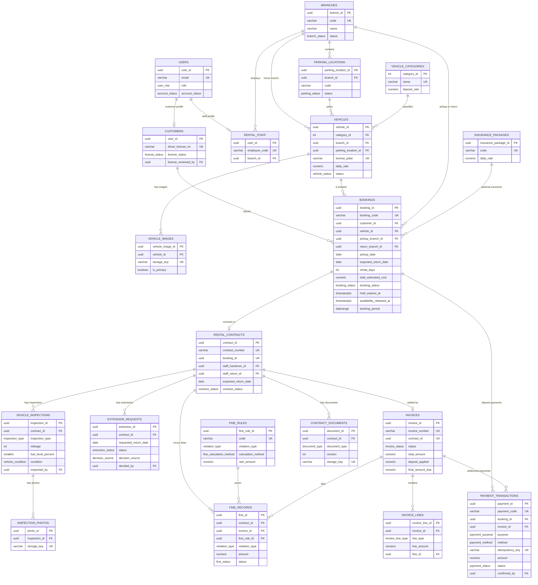
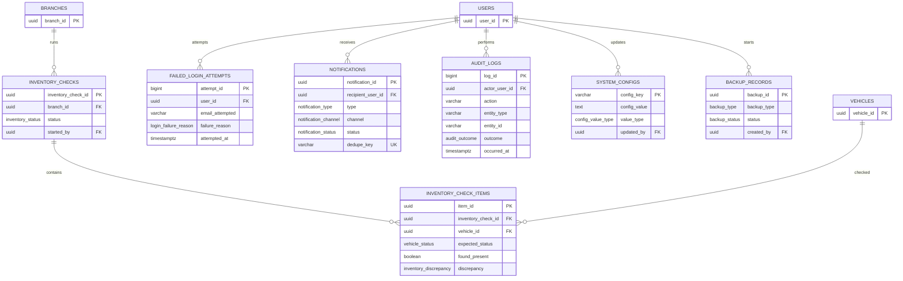

# Phase 1 — Database Design Proposal

**Project:** Vehicle Rental System (VRS)  
**Status:** Proposal only — `schema.prisma` has **not** been modified, no migration has been created, and no API/frontend code has been added.  
**Database target:** PostgreSQL 16, accessed through Prisma 7 in a later step.  
**Sources reviewed:** the preserved specification (`docs/specification/Vehicle_Rental_System11.docx`), the ERD, class diagram, DFD Level 0/1, the two use-case diagrams, and the Phase 0 Prisma configuration.

This document resolves the gaps in specification Section 6.4 using the approved MVP decisions. It is intentionally more specific than the source ERD because the source ERD does not contain tables for inspections, extension requests, payment transactions, notifications, inventory checks, contract documents, failed-login tracking, or PostgreSQL overlap enforcement.

---

## 1. Approved design decisions applied

| Topic | Decision used in this design |
|---|---|
| Rental duration | Calendar days. `pickup_date` and `expected_return_date` are `date`, not timestamps. |
| Rental interval | Half-open `[pickup_date, expected_return_date)`. Pickup on the 10th and return on the 12th = **2 rental days**. |
| Deposit | Percentage of the rental subtotal, configured on `vehicle_categories.deposit_rate`; snapshotted on each booking. |
| Fines | Structured, configurable `fine_rules`; assessed amounts are snapshotted in `fine_records`. |
| Unpaid fines | Any `fine_records.status = 'UNPAID'` blocks a new booking for that customer. |
| Administrator | `users.role = 'ADMIN'`; no `ADMINISTRATORS` table. |
| MVP roles | `CUSTOMER`, `STAFF`, `ADMIN`; no advanced RBAC tables yet. |
| Pending payment | `PENDING_PAYMENT` holds the vehicle for 30 minutes using `hold_expires_at`; expiry changes the booking to `CANCELLED`. |
| Deposit confirmation | Performed by Rental Staff and recorded as a `payment_transactions` row. |
| Extension | Automatically approved when all rules pass, and persisted in `extension_requests` for audit. |
| Online payments | Simulated only. No card/bank credentials are stored. |

### 1.1 Fundamental modelling choices

1. **Dates versus timestamps.** Rental pricing uses calendar dates (`date`). Operational events use `timestamptz` (actual pickup, actual return, payment time, audit time). This removes timezone ambiguity from the 2-day rule.
2. **Money.** `numeric(12,2)` for VND amounts, with non-negative checks. Currency is `char(3)` default `'VND'`.
3. **Identifiers.** UUID primary keys for business entities. `vehicle_categories.category_id` remains `integer` to match the supplied ERD. `audit_logs` and `failed_login_attempts` use `bigint` identity keys.
4. **Snapshots.** Bookings and contracts snapshot mutable rates/amounts so later administrator changes cannot rewrite history.
5. **Single availability source.** The `bookings` table is the schedule of record. Converted bookings remain in the exclusion constraint until the rental is returned or otherwise released. No persistent `RESERVED` vehicle status is used.
6. **No destructive deletes.** Users, vehicles, contracts, invoices, payments, and audit records are retained. Vehicles are `RETIRED`; users are `LOCKED`; financial records are `VOID` rather than deleted.
7. **Private files.** License images, inspection photos, and contract PDFs store opaque private-storage keys, never public URLs or raw binary data.

---

## 2. Entity list

### 2.1 Identity and access

| # | Entity | Purpose |
|---|---|---|
| 1 | `users` | One account table for CUSTOMER, STAFF, and ADMIN. |
| 2 | `customers` | 1:1 customer profile holding driver-licence data and verification state. |
| 3 | `rental_staff` | 1:1 staff profile holding employee code and assigned branch. |
| 4 | `failed_login_attempts` | Security log for the 5-attempt / 15-minute temporary lock rule. |

### 2.2 Branches and fleet

| # | Entity | Purpose |
|---|---|---|
| 5 | `branches` | Showroom/branch master data and opening hours. |
| 6 | `parking_locations` | Parking zones/spaces inside a branch. |
| 7 | `vehicle_categories` | Category and category-specific deposit rate. |
| 8 | `vehicles` | Fleet master, operational status, rate, mileage, branch assignment. |
| 9 | `vehicle_images` | Ordered gallery images for a vehicle. |
| 10 | `insurance_packages` | Optional insurance products and daily prices. |

### 2.3 Booking, contract, and inspection

| # | Entity | Purpose |
|---|---|---|
| 11 | `bookings` | Customer reservation, pricing snapshot, 30-minute hold, availability period. |
| 12 | `rental_contracts` | Contract created at handover; lifecycle and current return deadline. |
| 13 | `vehicle_inspections` | Pickup/return mileage, fuel, condition, inspector, notes. |
| 14 | `inspection_photos` | Private photos attached to an inspection. |
| 15 | `extension_requests` | Requested/approved/rejected extension and automatic-decision audit. |

### 2.4 Billing and payments

| # | Entity | Purpose |
|---|---|---|
| 16 | `fine_rules` | Administrator-configured fine types, rates, units, grace periods. |
| 17 | `fine_records` | Assessed fines with amount snapshot and paid/unpaid/waived state. |
| 18 | `invoices` | One settlement invoice per contract. |
| 19 | `invoice_lines` | Transparent rental/insurance/fine/discount breakdown. |
| 20 | `payment_transactions` | Deposit, settlement, fine, and refund transactions; idempotent. |
| 21 | `contract_documents` | Versioned generated contract PDFs and checksums. |

### 2.5 Operations and governance

| # | Entity | Purpose |
|---|---|---|
| 22 | `notifications` | In-app/email/SMS outbox, retry state, read state. |
| 23 | `inventory_checks` | Periodic branch inventory session. |
| 24 | `inventory_check_items` | Per-vehicle expected/found state and discrepancy. |
| 25 | `system_configs` | Typed, audited global parameters. |
| 26 | `audit_logs` | Append-only security/business audit trail. |
| 27 | `backup_records` | Optional/deferred metadata for backup and restore operations. |

**Not modelled in Phase 1 (deferred):** `ROLES`, `PERMISSIONS`, `ROLE_PERMISSIONS`, `USER_ROLES`, refresh-token/session tables, live payment-gateway callbacks, email/SMS provider credentials, and cloud backup replication.

---

## 3. Relationship list

| Parent | Child | Cardinality | FK / rule |
|---|---|---|---|
| `users` | `customers` | 1 : 0..1 | `customers.user_id` → `users.user_id`; only CUSTOMER role |
| `users` | `rental_staff` | 1 : 0..1 | `rental_staff.user_id` → `users.user_id`; only STAFF role |
| `branches` | `rental_staff` | 1 : 0..* | `rental_staff.branch_id` |
| `branches` | `parking_locations` | 1 : 0..* | `parking_locations.branch_id` |
| `branches` | `vehicles` | 1 : 0..* | `vehicles.branch_id` (home branch) |
| `parking_locations` | `vehicles` | 1 : 0..* | `vehicles.parking_location_id`; composite FK keeps the parking location in the same branch |
| `vehicle_categories` | `vehicles` | 1 : 0..* | `vehicles.category_id` |
| `vehicles` | `vehicle_images` | 1 : 0..* | `vehicle_images.vehicle_id`; one primary image |
| `customers` | `bookings` | 1 : 0..* | `bookings.customer_id` |
| `vehicles` | `bookings` | 1 : 0..* | `bookings.vehicle_id`; overlap excluded by GiST constraint |
| `branches` | `bookings` | 1 : 0..* | `bookings.pickup_branch_id`, `bookings.return_branch_id` |
| `insurance_packages` | `bookings` | 1 : 0..* | `bookings.insurance_package_id`, nullable |
| `bookings` | `rental_contracts` | 1 : 0..1 | `rental_contracts.booking_id` UNIQUE |
| `rental_contracts` | `vehicle_inspections` | 1 : 0..2 | One `PICKUP` and one `RETURN`; UNIQUE `(contract_id, inspection_type)` |
| `vehicle_inspections` | `inspection_photos` | 1 : 0..* | `inspection_photos.inspection_id` |
| `rental_contracts` | `extension_requests` | 1 : 0..* | `extension_requests.contract_id` |
| `rental_contracts` | `fine_records` | 1 : 0..* | `fine_records.contract_id` |
| `fine_rules` | `fine_records` | 1 : 0..* | `fine_records.fine_rule_id` |
| `rental_contracts` | `invoices` | 1 : 0..1 | `invoices.contract_id` UNIQUE |
| `invoices` | `invoice_lines` | 1 : 0..* | `invoice_lines.invoice_id` |
| `invoices` | `fine_records` | 1 : 0..* | `fine_records.invoice_id`, nullable until billing |
| `bookings` | `payment_transactions` | 1 : 0..* | Deposit payments (`booking_id`) |
| `invoices` | `payment_transactions` | 1 : 0..* | Settlement/refund payments (`invoice_id`) |
| `rental_contracts` | `contract_documents` | 1 : 0..* | Versioned PDFs |
| `users` | `notifications` | 1 : 0..* | Recipient |
| `branches` | `inventory_checks` | 1 : 0..* | Inventory session |
| `inventory_checks` | `inventory_check_items` | 1 : 0..* | Per-vehicle count |
| `vehicles` | `inventory_check_items` | 1 : 0..* | Vehicle being checked |
| `users` | `audit_logs` | 1 : 0..* | Actor; nullable for SYSTEM |
| `users` | `failed_login_attempts` | 1 : 0..* | Matched account, nullable for unknown email |
| `users` | `system_configs` | 1 : 0..* | Last updater |
| `users` | `backup_records` | 1 : 0..* | Administrator who started backup |

---

## 4. Data dictionary

Conventions: `PK` = primary key, `FK` = foreign key, `UK` = unique key, `CK` = check constraint. All `created_at`/`updated_at` values are `timestamptz NOT NULL DEFAULT now()` unless stated otherwise. UUID defaults use `gen_random_uuid()`.

### 4.1 `users`

All three roles share one identity row. Role-specific profile tables are extensions, not separate login identities.

| Column | Type | Constraints / notes |
|---|---|---|
| `user_id` | `uuid` | PK, default `gen_random_uuid()` |
| `full_name` | `varchar(100)` | NOT NULL |
| `email` | `varchar(254)` | NOT NULL; unique index on `lower(email)` |
| `phone` | `varchar(20)` | NOT NULL, UK |
| `national_id` | `varchar(20)` | NOT NULL, UK |
| `password_hash` | `varchar(255)` | NOT NULL; never plaintext |
| `role` | `user_role` | NOT NULL |
| `account_status` | `account_status` | NOT NULL DEFAULT `ACTIVE`; manual staff/admin lock |
| `address` | `text` | NULL |
| `avatar_key` | `varchar(500)` | NULL; private storage key |
| `failed_login_count` | `smallint` | NOT NULL DEFAULT 0, CK `>= 0`; current consecutive-failure counter |
| `login_locked_until` | `timestamptz` | NULL; temporary lock from failed logins |
| `last_failed_login_at` | `timestamptz` | NULL |
| `last_login_at` | `timestamptz` | NULL |
| `created_at` | `timestamptz` | NOT NULL DEFAULT now() |
| `updated_at` | `timestamptz` | NOT NULL DEFAULT now() |

Indexes: `lower(email)`, `phone`, `national_id`, `(role, account_status)`, `login_locked_until` (partial where not null).

> `account_status = LOCKED` is an **administrative** lock. The 15-minute failed-login lock uses `login_locked_until` so the two states are not confused.

### 4.2 `customers`

1:1 extension of `users` for role `CUSTOMER`. It owns the driver-licence submission and review state.

| Column | Type | Constraints / notes |
|---|---|---|
| `user_id` | `uuid` | PK, FK → `users.user_id` ON DELETE RESTRICT |
| `driver_license_no` | `varchar(30)` | NULL until submitted; UK when present |
| `license_class` | `varchar(10)` | NULL; optional licence class |
| `license_expiry_date` | `date` | NULL |
| `license_image_key` | `varchar(500)` | NULL; private storage key |
| `license_status` | `license_status` | NOT NULL DEFAULT `UNVERIFIED` |
| `license_submitted_at` | `timestamptz` | NULL |
| `license_reviewed_by` | `uuid` | NULL, FK → `users.user_id` ON DELETE SET NULL |
| `license_reviewed_at` | `timestamptz` | NULL |
| `license_rejection_reason` | `text` | NULL |
| `created_at` | `timestamptz` | NOT NULL DEFAULT now() |
| `updated_at` | `timestamptz` | NOT NULL DEFAULT now() |

Checks:
- `license_status <> 'REJECTED' OR license_rejection_reason IS NOT NULL`
- `license_status = 'UNVERIFIED' OR (driver_license_no IS NOT NULL AND license_image_key IS NOT NULL AND license_reviewed_at IS NOT NULL)`

Index: `(license_status, license_submitted_at)`.

> A resubmission sets `license_status = UNVERIFIED`, clears `license_reviewed_by`, `license_reviewed_at`, and `license_rejection_reason`, and writes an audit record. Review history is preserved in `audit_logs`.

### 4.3 `rental_staff`

1:1 extension of `users` for role `STAFF`.

| Column | Type | Constraints / notes |
|---|---|---|
| `user_id` | `uuid` | PK, FK → `users.user_id` ON DELETE RESTRICT |
| `employee_code` | `varchar(20)` | NOT NULL, UK |
| `branch_id` | `uuid` | NOT NULL, FK → `branches.branch_id` ON DELETE RESTRICT |
| `hired_at` | `date` | NULL |
| `created_at` | `timestamptz` | NOT NULL DEFAULT now() |
| `updated_at` | `timestamptz` | NOT NULL DEFAULT now() |

Index: `(branch_id, employee_code)`.

> `ADMIN` users have no profile sub-table. Role/profile consistency (for example, a CUSTOMER cannot have a `rental_staff` row) is enforced in the service layer and can be reinforced with a deferred trigger if desired.

### 4.4 `failed_login_attempts`

Security evidence for lockout and abuse detection. The password is never recorded.

| Column | Type | Constraints / notes |
|---|---|---|
| `attempt_id` | `bigint` | PK, identity |
| `user_id` | `uuid` | NULL, FK → `users.user_id` ON DELETE SET NULL |
| `email_attempted` | `varchar(254)` | NOT NULL; normalised lower-case |
| `ip_address` | `inet` | NULL |
| `user_agent` | `text` | NULL |
| `failure_reason` | `login_failure_reason` | NOT NULL |
| `attempted_at` | `timestamptz` | NOT NULL DEFAULT now() |

Indexes: `(lower(email_attempted), attempted_at DESC)`, `(ip_address, attempted_at DESC)`, `(user_id, attempted_at DESC)`.

Lock rule: count failures for the normalised email where `attempted_at > now() - interval '15 minutes'`. At 5, set `users.login_locked_until = now() + interval '15 minutes'`. A successful login resets `failed_login_count` and `login_locked_until`. A retention job should delete rows older than 90 days.

### 4.5 `branches`

| Column | Type | Constraints / notes |
|---|---|---|
| `branch_id` | `uuid` | PK |
| `code` | `varchar(20)` | NOT NULL, UK |
| `name` | `varchar(100)` | NOT NULL |
| `address` | `text` | NOT NULL |
| `phone` | `varchar(20)` | NULL |
| `email` | `varchar(254)` | NULL |
| `opening_time` | `time` | NOT NULL DEFAULT `08:00` |
| `closing_time` | `time` | NOT NULL DEFAULT `18:00` |
| `timezone` | `varchar(50)` | NOT NULL DEFAULT `'Asia/Ho_Chi_Minh'` |
| `status` | `branch_status` | NOT NULL DEFAULT `ACTIVE` |
| `created_at` | `timestamptz` | NOT NULL DEFAULT now() |
| `updated_at` | `timestamptz` | NOT NULL DEFAULT now() |

Check: `opening_time < closing_time`. Index: `(status, name)`.

### 4.6 `parking_locations`

| Column | Type | Constraints / notes |
|---|---|---|
| `parking_location_id` | `uuid` | PK |
| `branch_id` | `uuid` | NOT NULL, FK → `branches.branch_id` ON DELETE RESTRICT |
| `code` | `varchar(20)` | NOT NULL |
| `name` | `varchar(100)` | NOT NULL |
| `zone` | `varchar(50)` | NULL |
| `capacity` | `integer` | NULL, CK `> 0` |
| `status` | `parking_status` | NOT NULL DEFAULT `ACTIVE` |
| `notes` | `text` | NULL |
| `created_at` | `timestamptz` | NOT NULL DEFAULT now() |
| `updated_at` | `timestamptz` | NOT NULL DEFAULT now() |

Constraints: UNIQUE `(branch_id, code)`; UNIQUE `(parking_location_id, branch_id)` to support the composite vehicle FK. Index `(branch_id, status)`.

### 4.7 `vehicle_categories`

| Column | Type | Constraints / notes |
|---|---|---|
| `category_id` | `integer` | PK, identity |
| `name` | `varchar(50)` | NOT NULL, UK |
| `deposit_rate` | `numeric(5,2)` | NOT NULL, CK `BETWEEN 0 AND 100`; percent of rental subtotal |
| `description` | `text` | NULL |
| `is_active` | `boolean` | NOT NULL DEFAULT true |
| `created_at` | `timestamptz` | NOT NULL DEFAULT now() |
| `updated_at` | `timestamptz` | NOT NULL DEFAULT now() |

Seed values: `Sedan`, `SUV`, `Motorbike`, `Van`. Categories remain configurable; the source documents disagree between “Car” and “Sedan”, so names are data, not an enum.

### 4.8 `vehicles`

| Column | Type | Constraints / notes |
|---|---|---|
| `vehicle_id` | `uuid` | PK |
| `category_id` | `integer` | NOT NULL, FK → `vehicle_categories.category_id` ON DELETE RESTRICT |
| `branch_id` | `uuid` | NOT NULL, FK → `branches.branch_id` ON DELETE RESTRICT |
| `parking_location_id` | `uuid` | NULL |
| `license_plate` | `varchar(20)` | NOT NULL; unique index on `upper(license_plate)` |
| `vin` | `varchar(17)` | NULL, UK |
| `brand` | `varchar(50)` | NOT NULL |
| `model` | `varchar(50)` | NOT NULL |
| `manufacture_year` | `smallint` | NOT NULL, CK `BETWEEN 1900 AND 2100` |
| `transmission` | `transmission` | NOT NULL |
| `fuel_type` | `fuel_type` | NOT NULL |
| `seats` | `smallint` | NOT NULL, CK `> 0` |
| `daily_rate` | `numeric(12,2)` | NOT NULL, CK `> 0` |
| `current_mileage` | `integer` | NOT NULL DEFAULT 0, CK `>= 0` |
| `status` | `vehicle_status` | NOT NULL DEFAULT `AVAILABLE` |
| `retired_at` | `timestamptz` | NULL; required when status is `RETIRED` |
| `created_at` | `timestamptz` | NOT NULL DEFAULT now() |
| `updated_at` | `timestamptz` | NOT NULL DEFAULT now() |

Constraints:
- `FOREIGN KEY (parking_location_id, branch_id) REFERENCES parking_locations(parking_location_id, branch_id)`
- `status <> 'RETIRED' OR retired_at IS NOT NULL`
- Indexes: `(branch_id, status)`, `category_id`, `parking_location_id`.

> `RESERVED` is deliberately **not** a persisted vehicle status. It cannot represent non-overlapping future bookings. “Reserved” is derived from the booking schedule; the physical/operational states are `AVAILABLE`, `RENTED`, `MAINTENANCE`, `RETIRED`.

### 4.9 `vehicle_images`

| Column | Type | Constraints / notes |
|---|---|---|
| `vehicle_image_id` | `uuid` | PK |
| `vehicle_id` | `uuid` | NOT NULL, FK → `vehicles.vehicle_id` ON DELETE CASCADE |
| `storage_key` | `varchar(500)` | NOT NULL, UK; opaque private/public object key |
| `alt_text` | `varchar(200)` | NULL |
| `is_primary` | `boolean` | NOT NULL DEFAULT false |
| `sort_order` | `smallint` | NOT NULL DEFAULT 0 |
| `created_at` | `timestamptz` | NOT NULL DEFAULT now() |

Constraints: partial unique index `(vehicle_id) WHERE is_primary`; index `(vehicle_id, sort_order)`.

### 4.10 `insurance_packages`

| Column | Type | Constraints / notes |
|---|---|---|
| `insurance_package_id` | `uuid` | PK |
| `code` | `varchar(30)` | NOT NULL, UK |
| `name` | `varchar(100)` | NOT NULL |
| `daily_rate` | `numeric(12,2)` | NOT NULL, CK `>= 0` |
| `coverage_description` | `text` | NOT NULL |
| `is_active` | `boolean` | NOT NULL DEFAULT true |
| `created_at` | `timestamptz` | NOT NULL DEFAULT now() |
| `updated_at` | `timestamptz` | NOT NULL DEFAULT now() |

MVP allows at most one insurance package per booking. If multiple coverages are later required, add `booking_insurances` instead of adding more columns to `bookings`.

### 4.11 `bookings`

The booking row is the **authoritative availability record** for the vehicle.

| Column | Type | Constraints / notes |
|---|---|---|
| `booking_id` | `uuid` | PK |
| `booking_code` | `varchar(20)` | NOT NULL, UK; human/QR lookup code |
| `customer_id` | `uuid` | NOT NULL, FK → `customers.user_id` ON DELETE RESTRICT |
| `vehicle_id` | `uuid` | NOT NULL, FK → `vehicles.vehicle_id` ON DELETE RESTRICT |
| `pickup_branch_id` | `uuid` | NOT NULL, FK → `branches.branch_id` |
| `return_branch_id` | `uuid` | NOT NULL, FK → `branches.branch_id` |
| `pickup_date` | `date` | NOT NULL |
| `expected_return_date` | `date` | NOT NULL |
| `rental_days` | `integer` | NOT NULL; CK `= expected_return_date - pickup_date` |
| `daily_rate_snapshot` | `numeric(12,2)` | NOT NULL, CK `> 0` |
| `rental_subtotal` | `numeric(12,2)` | NOT NULL, CK `= rental_days * daily_rate_snapshot` |
| `deposit_rate_snapshot` | `numeric(5,2)` | NOT NULL, CK `BETWEEN 0 AND 100` |
| `deposit_amount` | `numeric(12,2)` | NOT NULL, CK `>= 0 AND <= total_estimated_cost` |
| `insurance_package_id` | `uuid` | NULL, FK → `insurance_packages.insurance_package_id` ON DELETE SET NULL |
| `insurance_name_snapshot` | `varchar(100)` | NULL |
| `insurance_daily_rate_snapshot` | `numeric(12,2)` | NULL, CK `>= 0` |
| `insurance_fee` | `numeric(12,2)` | NOT NULL DEFAULT 0, CK `= COALESCE(insurance_daily_rate_snapshot,0) * rental_days` |
| `total_estimated_cost` | `numeric(12,2)` | NOT NULL, CK `= rental_subtotal + insurance_fee` |
| `currency` | `char(3)` | NOT NULL DEFAULT `'VND'` |
| `booking_status` | `booking_status` | NOT NULL DEFAULT `PENDING_PAYMENT` |
| `hold_expires_at` | `timestamptz` | NOT NULL; set to `created_at + TTL` at creation |
| `confirmed_at` | `timestamptz` | NULL |
| `cancelled_at` | `timestamptz` | NULL |
| `cancellation_reason` | `booking_cancellation_reason` | NULL |
| `converted_at` | `timestamptz` | NULL |
| `availability_released_at` | `timestamptz` | NULL; set when the vehicle is returned or the schedule is released |
| `booking_period` | `daterange` | Generated always as `daterange(pickup_date, expected_return_date, '[)')` STORED |
| `created_at` | `timestamptz` | NOT NULL DEFAULT now() |
| `updated_at` | `timestamptz` | NOT NULL DEFAULT now() |

Checks:
- `expected_return_date > pickup_date`
- `rental_days = expected_return_date - pickup_date`
- `booking_status <> 'CANCELLED' OR cancelled_at IS NOT NULL`
- `booking_status <> 'CONFIRMED' OR confirmed_at IS NOT NULL`
- `booking_status <> 'CONVERTED_TO_CONTRACT' OR converted_at IS NOT NULL`
- `cancellation_reason IS NULL OR booking_status = 'CANCELLED'`

Indexes:
- GiST exclusion constraint (see §7.2) on `(vehicle_id, booking_period)` for active rows.
- `(customer_id, created_at DESC)`.
- `(vehicle_id, pickup_date)`.
- Partial index `(hold_expires_at) WHERE booking_status = 'PENDING_PAYMENT'`.
- `(booking_status, pickup_date)`.

> `rental_days` is stored, not generated, so Prisma can read it normally; the `CHECK` still guarantees it equals the date difference. `booking_period` requires a custom SQL migration.

### 4.12 `rental_contracts`

Created only at staff handover. It is the legal/operational rental record after conversion.

| Column | Type | Constraints / notes |
|---|---|---|
| `contract_id` | `uuid` | PK |
| `contract_number` | `varchar(30)` | NOT NULL, UK |
| `booking_id` | `uuid` | NOT NULL, UK, FK → `bookings.booking_id` ON DELETE RESTRICT |
| `staff_handover_id` | `uuid` | NOT NULL, FK → `users.user_id` |
| `staff_return_id` | `uuid` | NULL, FK → `users.user_id` |
| `actual_pickup_at` | `timestamptz` | NOT NULL |
| `expected_return_date` | `date` | NOT NULL; current deadline after approved extensions |
| `actual_return_at` | `timestamptz` | NULL |
| `contract_status` | `contract_status` | NOT NULL DEFAULT `ACTIVE` |
| `completed_at` | `timestamptz` | NULL |
| `created_at` | `timestamptz` | NOT NULL DEFAULT now() |
| `updated_at` | `timestamptz` | NOT NULL DEFAULT now() |

Checks:
- `actual_return_at IS NULL OR actual_return_at >= actual_pickup_at`
- `contract_status <> 'COMPLETED' OR (actual_return_at IS NOT NULL AND completed_at IS NOT NULL AND staff_return_id IS NOT NULL)`
- `expected_return_date >= actual_pickup_at::date`

Indexes: unique `booking_id`; `(contract_status, expected_return_date)`; `(staff_handover_id)`; `(staff_return_id)`.

> Mileage, fuel, and condition are **not duplicated** on the contract. They live in `vehicle_inspections`, which has exactly one `PICKUP` and at most one `RETURN` row per contract. This resolves the ERD/class-diagram duplication.

### 4.13 `vehicle_inspections`

| Column | Type | Constraints / notes |
|---|---|---|
| `inspection_id` | `uuid` | PK |
| `contract_id` | `uuid` | NOT NULL, FK → `rental_contracts.contract_id` ON DELETE RESTRICT |
| `inspection_type` | `inspection_type` | NOT NULL |
| `mileage` | `integer` | NOT NULL, CK `>= 0` |
| `fuel_level_percent` | `smallint` | NOT NULL, CK `BETWEEN 0 AND 100` |
| `condition` | `vehicle_condition` | NOT NULL |
| `notes` | `text` | NULL |
| `inspected_by` | `uuid` | NOT NULL, FK → `users.user_id` |
| `inspected_at` | `timestamptz` | NOT NULL |
| `created_at` | `timestamptz` | NOT NULL DEFAULT now() |

Constraints: UNIQUE `(contract_id, inspection_type)`. Index `(contract_id, inspected_at)`.

Business checks in the service transaction:
- a `PICKUP` inspection must exist before the contract becomes `ACTIVE`;
- a `RETURN` inspection is required before the contract becomes `COMPLETED`;
- return mileage `>=` pickup mileage;
- if return condition is `DAMAGED`, the vehicle becomes `MAINTENANCE` and a damage fine may be assessed.

### 4.14 `inspection_photos`

| Column | Type | Constraints / notes |
|---|---|---|
| `photo_id` | `uuid` | PK |
| `inspection_id` | `uuid` | NOT NULL, FK → `vehicle_inspections.inspection_id` ON DELETE CASCADE |
| `storage_key` | `varchar(500)` | NOT NULL, UK; private storage |
| `caption` | `varchar(200)` | NULL |
| `sort_order` | `smallint` | NOT NULL DEFAULT 0 |
| `created_at` | `timestamptz` | NOT NULL DEFAULT now() |

Index: `(inspection_id, sort_order)`.

### 4.15 `extension_requests`

Every request is stored, including automatically rejected ones, so the audit trail answers “why was this approved/rejected?”.

| Column | Type | Constraints / notes |
|---|---|---|
| `extension_id` | `uuid` | PK |
| `contract_id` | `uuid` | NOT NULL, FK → `rental_contracts.contract_id` ON DELETE RESTRICT |
| `requested_by` | `uuid` | NOT NULL, FK → `customers.user_id` |
| `requested_at` | `timestamptz` | NOT NULL DEFAULT now() |
| `current_return_date` | `date` | NOT NULL |
| `requested_return_date` | `date` | NOT NULL |
| `additional_days` | `integer` | NOT NULL, CK `= requested_return_date - current_return_date` and `> 0` |
| `additional_amount` | `numeric(12,2)` | NOT NULL, CK `>= 0` |
| `reason` | `text` | NULL |
| `status` | `extension_status` | NOT NULL DEFAULT `PENDING` |
| `decision_source` | `decision_source` | NULL; `SYSTEM` for automatic decision |
| `decided_by` | `uuid` | NULL, FK → `users.user_id` |
| `decided_at` | `timestamptz` | NULL |
| `decision_reason` | `text` | NULL; machine-readable code plus human explanation |
| `created_at` | `timestamptz` | NOT NULL DEFAULT now() |
| `updated_at` | `timestamptz` | NOT NULL DEFAULT now() |

Constraints: `requested_return_date > current_return_date`; UNIQUE `(contract_id, requested_return_date)`; `status = 'PENDING' OR decided_at IS NOT NULL`. Index `(contract_id, status)`.

### 4.16 `fine_rules`

Administrator-configurable rates. Rates are never hard-coded in application logic.

| Column | Type | Constraints / notes |
|---|---|---|
| `fine_rule_id` | `uuid` | PK |
| `code` | `varchar(30)` | NOT NULL, UK |
| `name` | `varchar(100)` | NOT NULL |
| `violation_type` | `violation_type` | NOT NULL |
| `calculation_method` | `fine_calculation_method` | NOT NULL |
| `rate_amount` | `numeric(12,2)` | NOT NULL, CK `>= 0` |
| `unit_label` | `varchar(20)` | NULL, e.g. `hour`, `day`, `litre`, `percent` |
| `grace_minutes` | `integer` | NOT NULL DEFAULT 0, CK `>= 0` |
| `max_amount` | `numeric(12,2)` | NULL, CK `>= rate_amount` |
| `is_active` | `boolean` | NOT NULL DEFAULT true |
| `effective_from` | `timestamptz` | NOT NULL DEFAULT now() |
| `effective_to` | `timestamptz` | NULL |
| `created_by` | `uuid` | NULL, FK → `users.user_id` ON DELETE SET NULL |
| `updated_by` | `uuid` | NULL, FK → `users.user_id` ON DELETE SET NULL |
| `created_at` | `timestamptz` | NOT NULL DEFAULT now() |
| `updated_at` | `timestamptz` | NOT NULL DEFAULT now() |

Check: `effective_to IS NULL OR effective_to > effective_from`. Index `(violation_type, is_active, effective_from)`.

Seed examples: `LATE_HOURLY`, `LATE_DAILY`, `FUEL_SHORTAGE_PER_LITRE`, `EXTERIOR_DAMAGE`, `INTERIOR_DAMAGE`, `CLEANING`.

### 4.17 `fine_records`

One row per assessed violation. `amount` is a snapshot; later rule changes do not alter history.

| Column | Type | Constraints / notes |
|---|---|---|
| `fine_id` | `uuid` | PK |
| `contract_id` | `uuid` | NOT NULL, FK → `rental_contracts.contract_id` ON DELETE RESTRICT |
| `invoice_id` | `uuid` | NULL, FK → `invoices.invoice_id` ON DELETE SET NULL |
| `fine_rule_id` | `uuid` | NOT NULL, FK → `fine_rules.fine_rule_id` ON DELETE RESTRICT |
| `violation_type` | `violation_type` | NOT NULL; snapshot |
| `description` | `text` | NULL |
| `quantity` | `numeric(12,2)` | NOT NULL DEFAULT 1, CK `> 0` |
| `unit_amount` | `numeric(12,2)` | NOT NULL, CK `>= 0` |
| `amount` | `numeric(12,2)` | NOT NULL, CK `= quantity * unit_amount` |
| `status` | `fine_status` | NOT NULL DEFAULT `UNPAID` |
| `assessed_by` | `uuid` | NOT NULL, FK → `users.user_id` |
| `assessed_at` | `timestamptz` | NOT NULL DEFAULT now() |
| `settled_at` | `timestamptz` | NULL |
| `settlement_type` | `fine_settlement_type` | NULL; `PAYMENT`, `DEPOSIT`, or `WAIVER` |
| `waiver_reason` | `text` | NULL |
| `created_at` | `timestamptz` | NOT NULL DEFAULT now() |
| `updated_at` | `timestamptz` | NOT NULL DEFAULT now() |

Checks:
- `status = 'UNPAID' OR settled_at IS NOT NULL`
- `status <> 'WAIVED' OR waiver_reason IS NOT NULL`

Indexes: `(contract_id, status)`, `(invoice_id)`, `(assessed_at)`.

> The source `is_paid` boolean is replaced by `status`. A paid/waived fine is settled; an unpaid fine is the blocker used by booking eligibility.

### 4.18 `invoices`

Exactly one settlement invoice per contract.

| Column | Type | Constraints / notes |
|---|---|---|
| `invoice_id` | `uuid` | PK |
| `invoice_number` | `varchar(30)` | NOT NULL, UK |
| `contract_id` | `uuid` | NOT NULL, UK, FK → `rental_contracts.contract_id` ON DELETE RESTRICT |
| `status` | `invoice_status` | NOT NULL DEFAULT `UNPAID` |
| `rental_fee` | `numeric(12,2)` | NOT NULL, CK `>= 0` |
| `insurance_fee` | `numeric(12,2)` | NOT NULL DEFAULT 0, CK `>= 0` |
| `fine_fee` | `numeric(12,2)` | NOT NULL DEFAULT 0, CK `>= 0` |
| `discount_amount` | `numeric(12,2)` | NOT NULL DEFAULT 0, CK `>= 0` |
| `total_amount` | `numeric(12,2)` | NOT NULL, CK `= rental_fee + insurance_fee + fine_fee - discount_amount` |
| `deposit_amount` | `numeric(12,2)` | NOT NULL DEFAULT 0, CK `>= 0` |
| `deposit_applied` | `numeric(12,2)` | NOT NULL DEFAULT 0, CK `BETWEEN 0 AND deposit_amount` |
| `final_amount_due` | `numeric(12,2)` | NOT NULL; signed: positive = customer owes, negative = refund owed |
| `amount_paid` | `numeric(12,2)` | NOT NULL DEFAULT 0, CK `>= 0` |
| `refund_amount` | `numeric(12,2)` | NOT NULL DEFAULT 0, CK `>= 0` |
| `currency` | `char(3)` | NOT NULL DEFAULT `'VND'` |
| `issued_at` | `timestamptz` | NOT NULL DEFAULT now() |
| `due_at` | `timestamptz` | NULL |
| `paid_at` | `timestamptz` | NULL |
| `created_at` | `timestamptz` | NOT NULL DEFAULT now() |
| `updated_at` | `timestamptz` | NOT NULL DEFAULT now() |

Check: `final_amount_due = total_amount - deposit_applied`. Index `(status, due_at)`; unique `contract_id`.

> `payment_method` is removed from `invoices`; it belongs to `payment_transactions`. A negative `final_amount_due` is the refund owed before any refund transaction. `refund_amount` records the amount actually refunded.

### 4.19 `invoice_lines`

Transparent breakdown of every charge. Discounts are negative lines.

| Column | Type | Constraints / notes |
|---|---|---|
| `invoice_line_id` | `uuid` | PK |
| `invoice_id` | `uuid` | NOT NULL, FK → `invoices.invoice_id` ON DELETE CASCADE |
| `line_type` | `invoice_line_type` | NOT NULL |
| `description` | `varchar(255)` | NOT NULL |
| `quantity` | `numeric(12,2)` | NOT NULL DEFAULT 1, CK `> 0` |
| `unit_amount` | `numeric(12,2)` | NOT NULL; may be negative for a discount |
| `line_amount` | `numeric(12,2)` | NOT NULL, CK `= quantity * unit_amount` |
| `fine_id` | `uuid` | NULL, UK, FK → `fine_records.fine_id` ON DELETE SET NULL |
| `sort_order` | `smallint` | NOT NULL DEFAULT 0 |
| `created_at` | `timestamptz` | NOT NULL DEFAULT now() |

Index: `(invoice_id, sort_order)`.

### 4.20 `payment_transactions`

Deposit confirmation, final settlement, fine payment, and refunds. No raw card or bank details are stored.

| Column | Type | Constraints / notes |
|---|---|---|
| `payment_id` | `uuid` | PK |
| `payment_code` | `varchar(30)` | NOT NULL, UK |
| `booking_id` | `uuid` | NULL, FK → `bookings.booking_id` |
| `invoice_id` | `uuid` | NULL, FK → `invoices.invoice_id` |
| `purpose` | `payment_purpose` | NOT NULL |
| `method` | `payment_method` | NOT NULL |
| `provider` | `varchar(30)` | NOT NULL; `COUNTER`, `SIMULATED`, etc. |
| `provider_transaction_ref` | `varchar(100)` | NULL; unique where not null |
| `idempotency_key` | `varchar(100)` | NOT NULL, UK |
| `amount` | `numeric(12,2)` | NOT NULL, CK `> 0` |
| `currency` | `char(3)` | NOT NULL DEFAULT `'VND'` |
| `status` | `payment_status` | NOT NULL DEFAULT `PENDING` |
| `confirmed_by` | `uuid` | NULL, FK → `users.user_id`; staff for counter/simulated payments |
| `confirmed_at` | `timestamptz` | NULL |
| `failure_reason` | `text` | NULL |
| `notes` | `text` | NULL |
| `created_at` | `timestamptz` | NOT NULL DEFAULT now() |
| `updated_at` | `timestamptz` | NOT NULL DEFAULT now() |

Checks:
- `booking_id IS NOT NULL OR invoice_id IS NOT NULL`
- `(purpose = 'DEPOSIT' AND booking_id IS NOT NULL AND invoice_id IS NULL) OR (purpose IN ('SETTLEMENT','FINE') AND invoice_id IS NOT NULL AND booking_id IS NULL) OR (purpose IN ('REFUND','ADJUSTMENT') AND (invoice_id IS NOT NULL OR booking_id IS NOT NULL))`
- `status <> 'SUCCEEDED' OR confirmed_at IS NOT NULL`

Indexes: `(booking_id)`, `(invoice_id)`, `(status, created_at)`, unique `provider_transaction_ref` where not null.

### 4.21 `contract_documents`

Versioned PDF metadata. Files live in private storage.

| Column | Type | Constraints / notes |
|---|---|---|
| `document_id` | `uuid` | PK |
| `contract_id` | `uuid` | NOT NULL, FK → `rental_contracts.contract_id` ON DELETE RESTRICT |
| `document_type` | `document_type` | NOT NULL |
| `version` | `integer` | NOT NULL DEFAULT 1, CK `> 0` |
| `storage_key` | `varchar(500)` | NOT NULL, UK |
| `mime_type` | `varchar(100)` | NOT NULL DEFAULT `'application/pdf'` |
| `size_bytes` | `bigint` | NOT NULL, CK `> 0` |
| `sha256` | `char(64)` | NOT NULL |
| `generated_by` | `uuid` | NULL, FK → `users.user_id` |
| `generated_at` | `timestamptz` | NOT NULL DEFAULT now() |
| `is_current` | `boolean` | NOT NULL DEFAULT true |
| `created_at` | `timestamptz` | NOT NULL DEFAULT now() |

Constraints: UNIQUE `(contract_id, document_type, version)`; partial unique `(contract_id, document_type) WHERE is_current`. Index `(contract_id, document_type, version DESC)`.

### 4.22 `notifications`

Outbox-style table. Core transactions only insert a notification row; delivery failures must not roll back bookings or payments.

| Column | Type | Constraints / notes |
|---|---|---|
| `notification_id` | `uuid` | PK |
| `recipient_user_id` | `uuid` | NOT NULL, FK → `users.user_id` ON DELETE CASCADE |
| `type` | `notification_type` | NOT NULL |
| `channel` | `notification_channel` | NOT NULL DEFAULT `IN_APP` |
| `title` | `varchar(150)` | NOT NULL |
| `body` | `text` | NOT NULL |
| `related_entity_type` | `varchar(50)` | NULL |
| `related_entity_id` | `varchar(64)` | NULL; UUID or config key |
| `dedupe_key` | `varchar(150)` | NULL, UK; prevents duplicate reminders |
| `status` | `notification_status` | NOT NULL DEFAULT `PENDING` |
| `scheduled_at` | `timestamptz` | NOT NULL DEFAULT now() |
| `sent_at` | `timestamptz` | NULL |
| `read_at` | `timestamptz` | NULL |
| `retry_count` | `smallint` | NOT NULL DEFAULT 0, CK `>= 0` |
| `last_error` | `text` | NULL |
| `metadata` | `jsonb` | NULL |
| `created_at` | `timestamptz` | NOT NULL DEFAULT now() |
| `updated_at` | `timestamptz` | NOT NULL DEFAULT now() |

Checks: `status <> 'SENT' OR sent_at IS NOT NULL`; `status <> 'READ' OR read_at IS NOT NULL`.

Indexes: `(recipient_user_id, status, scheduled_at)`, `(channel, status, scheduled_at)`, unique `dedupe_key` where not null.

### 4.23 `inventory_checks`

| Column | Type | Constraints / notes |
|---|---|---|
| `inventory_check_id` | `uuid` | PK |
| `check_number` | `varchar(30)` | NOT NULL, UK |
| `branch_id` | `uuid` | NOT NULL, FK → `branches.branch_id` |
| `status` | `inventory_status` | NOT NULL DEFAULT `IN_PROGRESS` |
| `started_by` | `uuid` | NOT NULL, FK → `users.user_id` |
| `started_at` | `timestamptz` | NOT NULL DEFAULT now() |
| `completed_by` | `uuid` | NULL, FK → `users.user_id` |
| `completed_at` | `timestamptz` | NULL |
| `notes` | `text` | NULL |
| `created_at` | `timestamptz` | NOT NULL DEFAULT now() |
| `updated_at` | `timestamptz` | NOT NULL DEFAULT now() |

Check: `status <> 'COMPLETED' OR (completed_at IS NOT NULL AND completed_by IS NOT NULL)`. Index `(branch_id, status, started_at DESC)`.

### 4.24 `inventory_check_items`

| Column | Type | Constraints / notes |
|---|---|---|
| `item_id` | `uuid` | PK |
| `inventory_check_id` | `uuid` | NOT NULL, FK → `inventory_checks.inventory_check_id` ON DELETE CASCADE |
| `vehicle_id` | `uuid` | NOT NULL, FK → `vehicles.vehicle_id` |
| `expected_status` | `vehicle_status` | NOT NULL |
| `found_present` | `boolean` | NOT NULL DEFAULT false |
| `actual_status` | `vehicle_status` | NULL |
| `found_branch_id` | `uuid` | NULL, FK → `branches.branch_id` |
| `discrepancy` | `inventory_discrepancy` | NOT NULL DEFAULT `NONE` |
| `notes` | `text` | NULL |
| `photo_key` | `varchar(500)` | NULL |
| `checked_by` | `uuid` | NOT NULL, FK → `users.user_id` |
| `checked_at` | `timestamptz` | NOT NULL DEFAULT now() |

Constraints: UNIQUE `(inventory_check_id, vehicle_id)`. Indexes: `(inventory_check_id)`, `(vehicle_id, checked_at DESC)`, `(discrepancy)`.

### 4.25 `system_configs`

| Column | Type | Constraints / notes |
|---|---|---|
| `config_key` | `varchar(80)` | PK |
| `config_value` | `text` | NOT NULL |
| `value_type` | `config_value_type` | NOT NULL |
| `category` | `varchar(50)` | NOT NULL |
| `description` | `text` | NULL |
| `is_public` | `boolean` | NOT NULL DEFAULT false |
| `version` | `integer` | NOT NULL DEFAULT 1, CK `> 0` |
| `updated_by` | `uuid` | NULL, FK → `users.user_id` ON DELETE SET NULL |
| `created_at` | `timestamptz` | NOT NULL DEFAULT now() |
| `updated_at` | `timestamptz` | NOT NULL DEFAULT now() |

Index: `(category, config_key)`.

Recommended seed keys:

| Key | Type | Default | Meaning |
|---|---|---|---|
| `PENDING_BOOKING_TTL_MINUTES` | INTEGER | `30` | Hold duration for new pending bookings |
| `MAX_RENTAL_DAYS` | INTEGER | `30` | Maximum rental/extension duration |
| `MIN_RENTAL_DAYS` | INTEGER | `1` | Minimum billable rental duration |
| `DEFAULT_CURRENCY` | STRING | `VND` | Reporting/display default |
| `TIMEZONE` | STRING | `Asia/Ho_Chi_Minh` | Display/business timezone |
| `LATE_RETURN_GRACE_MINUTES` | INTEGER | `0` | Grace before late-fee calculation |

Fine rates are **not** stored here; they are structured `fine_rules` rows.

### 4.26 `audit_logs`

Append-only evidence. No application path may update or delete a row.

| Column | Type | Constraints / notes |
|---|---|---|
| `log_id` | `bigint` | PK, identity |
| `actor_user_id` | `uuid` | NULL, FK → `users.user_id` ON DELETE RESTRICT; NULL for SYSTEM jobs |
| `actor_role` | `user_role` | NULL; snapshot |
| `action` | `varchar(80)` | NOT NULL, e.g. `BOOKING_CREATED`, `PRICE_CHANGED` |
| `entity_type` | `varchar(50)` | NOT NULL |
| `entity_id` | `varchar(64)` | NULL |
| `outcome` | `audit_outcome` | NOT NULL |
| `before_data` | `jsonb` | NULL; redacted |
| `after_data` | `jsonb` | NULL; redacted |
| `ip_address` | `inet` | NULL |
| `user_agent` | `text` | NULL |
| `request_id` | `uuid` | NULL; correlates one request/job |
| `reason` | `text` | NULL |
| `occurred_at` | `timestamptz` | NOT NULL DEFAULT now() |

Indexes: `(occurred_at DESC)`, `(actor_user_id, occurred_at DESC)`, `(entity_type, entity_id, occurred_at DESC)`, `(action, occurred_at DESC)`.

Immutability: revoke `UPDATE`/`DELETE` from the application role, or add a trigger that raises an exception. Never log passwords, tokens, or full licence-image contents.

### 4.27 `backup_records` (optional/deferred)

| Column | Type | Constraints / notes |
|---|---|---|
| `backup_id` | `uuid` | PK |
| `backup_type` | `backup_type` | NOT NULL |
| `status` | `backup_status` | NOT NULL DEFAULT `PENDING` |
| `primary_location` | `varchar(500)` | NOT NULL |
| `secondary_location` | `varchar(500)` | NULL |
| `size_bytes` | `bigint` | NULL, CK `>= 0` |
| `checksum` | `varchar(128)` | NULL |
| `started_at` | `timestamptz` | NOT NULL DEFAULT now() |
| `completed_at` | `timestamptz` | NULL |
| `created_by` | `uuid` | NOT NULL, FK → `users.user_id` |
| `error_message` | `text` | NULL |
| `created_at` | `timestamptz` | NOT NULL DEFAULT now() |

Index: `(status, started_at DESC)`.

---

## 5. Enumerations

| Enum | Values | Notes |
|---|---|---|
| `user_role` | `CUSTOMER`, `STAFF`, `ADMIN` | No separate ADMIN table |
| `account_status` | `ACTIVE`, `LOCKED` | Manual administrative lock |
| `license_status` | `UNVERIFIED`, `VERIFIED`, `REJECTED` | Resubmission returns to `UNVERIFIED` |
| `login_failure_reason` | `INVALID_CREDENTIALS`, `UNKNOWN_EMAIL`, `TEMPORARILY_LOCKED`, `ACCOUNT_LOCKED` | No password data |
| `branch_status` | `ACTIVE`, `INACTIVE` | |
| `parking_status` | `ACTIVE`, `INACTIVE` | |
| `transmission` | `AUTO`, `MANUAL` | |
| `fuel_type` | `PETROL`, `DIESEL`, `ELECTRIC`, `HYBRID` | Additional UI field needed by catalog |
| `vehicle_status` | `AVAILABLE`, `RENTED`, `MAINTENANCE`, `RETIRED` | `RESERVED` removed |
| `booking_status` | `PENDING_PAYMENT`, `CONFIRMED`, `CANCELLED`, `CONVERTED_TO_CONTRACT` | |
| `booking_cancellation_reason` | `PAYMENT_TIMEOUT`, `CUSTOMER_CANCELLED`, `STAFF_CANCELLED`, `NO_SHOW`, `VEHICLE_UNAVAILABLE`, `OTHER` | Makes timeout distinct without a new status |
| `contract_status` | `ACTIVE`, `OVERDUE`, `COMPLETED` | |
| `inspection_type` | `PICKUP`, `RETURN` | One of each per contract |
| `vehicle_condition` | `INTACT`, `SCRATCHED`, `DAMAGED` | |
| `extension_status` | `PENDING`, `APPROVED`, `REJECTED`, `WITHDRAWN` | Auto-decision normally immediate |
| `decision_source` | `SYSTEM`, `STAFF` | |
| `violation_type` | `LATE_RETURN`, `FUEL_SHORTAGE`, `EXTERIOR_DAMAGE`, `INTERIOR_DAMAGE`, `CLEANING`, `OTHER` | Adds interior damage/cleaning |
| `fine_calculation_method` | `FIXED`, `PER_HOUR`, `PER_DAY`, `PER_LITER`, `PER_PERCENT` | |
| `fine_status` | `UNPAID`, `PAID`, `WAIVED` | |
| `fine_settlement_type` | `PAYMENT`, `DEPOSIT`, `WAIVER` | |
| `invoice_status` | `UNPAID`, `PARTIALLY_PAID`, `PAID`, `REFUNDED`, `VOID` | |
| `invoice_line_type` | `RENTAL`, `INSURANCE`, `LATE_FEE`, `FUEL_FEE`, `DAMAGE_FEE`, `CLEANING_FEE`, `OTHER_FEE`, `DISCOUNT` | |
| `payment_purpose` | `DEPOSIT`, `SETTLEMENT`, `FINE`, `REFUND`, `ADJUSTMENT` | |
| `payment_method` | `CASH`, `SIMULATED_ONLINE` | No live gateway |
| `payment_status` | `PENDING`, `SUCCEEDED`, `FAILED`, `REFUNDED`, `CANCELLED` | |
| `notification_type` | `BOOKING_CONFIRMED`, `BOOKING_CANCELLED`, `PAYMENT_RECEIVED`, `PICKUP_REMINDER`, `RETURN_REMINDER`, `CONTRACT_OVERDUE`, `LICENSE_VERIFIED`, `LICENSE_REJECTED`, `FINE_ISSUED`, `EXTENSION_APPROVED`, `EXTENSION_REJECTED`, `ACCOUNT_LOCKED`, `SYSTEM` | |
| `notification_channel` | `IN_APP`, `EMAIL`, `SMS` | Email/SMS delivery deferred |
| `notification_status` | `PENDING`, `SENT`, `FAILED`, `READ`, `CANCELLED` | |
| `inventory_status` | `IN_PROGRESS`, `COMPLETED`, `CANCELLED` | |
| `inventory_discrepancy` | `NONE`, `MISSING`, `UNEXPECTED`, `STATUS_MISMATCH`, `WRONG_BRANCH`, `DAMAGED` | |
| `document_type` | `RENTAL_CONTRACT`, `RECEIPT`, `OTHER` | |
| `config_value_type` | `STRING`, `INTEGER`, `DECIMAL`, `BOOLEAN`, `JSON` | |
| `audit_outcome` | `SUCCESS`, `FAILURE` | |
| `backup_type` | `FULL`, `INCREMENTAL` | Deferred |
| `backup_status` | `PENDING`, `RUNNING`, `COMPLETED`, `FAILED`, `RESTORED` | Deferred |

---

## 6. Status transitions

| Entity | Allowed transitions | Guard |
|---|---|---|
| Account | `ACTIVE → LOCKED → ACTIVE` | Staff/admin action, reason, audit |
| Temporary login lock | `unlocked → locked_until → unlocked` | 5 failures / 15 minutes; successful login or expiry |
| Licence | `UNVERIFIED → VERIFIED`; `UNVERIFIED → REJECTED`; `REJECTED → UNVERIFIED` (resubmit) | Reviewer + timestamp; rejection reason |
| Vehicle | `AVAILABLE → RENTED`; `RENTED → AVAILABLE`; `RENTED → MAINTENANCE`; `AVAILABLE → MAINTENANCE`; `MAINTENANCE → AVAILABLE`; non-rented → `RETIRED` | Handover/return inspection; cannot retire a rented vehicle |
| Booking | `PENDING_PAYMENT → CONFIRMED`; `PENDING_PAYMENT → CANCELLED`; `CONFIRMED → CANCELLED`; `CONFIRMED → CONVERTED_TO_CONTRACT` | Payment/expiry/handover; `CANCELLED` and `CONVERTED_TO_CONTRACT` are terminal |
| Contract | `ACTIVE → OVERDUE`; `ACTIVE → COMPLETED`; `OVERDUE → COMPLETED` | Scheduler or return; no reopening |
| Extension | `PENDING → APPROVED`; `PENDING → REJECTED`; `PENDING → WITHDRAWN` | Automatic decision source `SYSTEM` |
| Invoice | `UNPAID → PARTIALLY_PAID → PAID`; `UNPAID → VOID`; `PAID → REFUNDED` | Settlement/refund; MVP normally full payment |
| Payment | `PENDING → SUCCEEDED`; `PENDING → FAILED`; `PENDING → CANCELLED`; `SUCCEEDED → REFUNDED` | Idempotent confirmation |
| Fine | `UNPAID → PAID`; `UNPAID → WAIVED` | Payment/deposit settlement or admin waiver |
| Inventory | `IN_PROGRESS → COMPLETED`; `IN_PROGRESS → CANCELLED` | Completion requires completer/time |
| Notification | `PENDING → SENT → READ`; `PENDING → FAILED → PENDING`; `PENDING → CANCELLED` | Retry-safe delivery |

---

## 7. ERD (Mermaid)

### 7.1 Core transactional ERD



### 7.2 Supporting ERD



---

## 8. Business constraints and enforcement

### 8.1 Calendar-day rental calculation

`pickup_date` and `expected_return_date` are `date`. The number of billable days is:

```text
rental_days = expected_return_date - pickup_date
```

Examples:

| Pickup | Return | Rental days | Billable interval |
|---|---|---|---|
| 2026-03-10 | 2026-03-12 | 2 | `[2026-03-10, 2026-03-12)` |
| 2026-03-10 | 2026-03-11 | 1 | `[2026-03-10, 2026-03-11)` |
| 2026-03-10 | 2026-03-10 | invalid | zero-day rental |

Database checks enforce `expected_return_date > pickup_date` and `rental_days = expected_return_date - pickup_date`. Pricing is snapshotted at booking time:

```text
rental_subtotal = rental_days × daily_rate_snapshot
insurance_fee   = rental_days × insurance_daily_rate_snapshot (if selected)
total_estimated = rental_subtotal + insurance_fee
deposit_amount  = round(rental_subtotal × deposit_rate_snapshot / 100, 2)
```

The deposit base is the rental subtotal by default; this is called out as a clarification item because the specification does not say whether insurance is included.

### 8.2 Preventing overlapping bookings in PostgreSQL

The schedule of record is `bookings`. It has a generated half-open `daterange`:

```sql
CREATE EXTENSION IF NOT EXISTS btree_gist;

ALTER TABLE bookings
  ADD COLUMN booking_period daterange
  GENERATED ALWAYS AS (
    daterange(pickup_date, expected_return_date, '[)')
  ) STORED;

ALTER TABLE bookings
  ADD CONSTRAINT bookings_vehicle_no_overlap
  EXCLUDE USING gist (
    vehicle_id WITH =,
    booking_period WITH &&
  )
  WHERE (
    booking_status IN (
      'PENDING_PAYMENT',
      'CONFIRMED',
      'CONVERTED_TO_CONTRACT'
    )
    AND availability_released_at IS NULL
  );
```

Why this works:

- `[)` means a booking ending on the 12th and another starting on the 12th **do not** overlap.
- `PENDING_PAYMENT` is included, so the 30-minute hold is a real database-level hold.
- `CONFIRMED` is included.
- `CONVERTED_TO_CONTRACT` remains included while the vehicle is out, so a future booking cannot be inserted inside the active rental period.
- `availability_released_at` is set on early return or when staff release the schedule. The booking remains for history but stops blocking future dates.
- The exclusion constraint is enforced against concurrent inserts/updates by PostgreSQL; two simultaneous requests cannot both commit overlapping active rows.

The syntax above was validated against the project’s PostgreSQL 16.16 container using a rolled-back scratch table: an overlapping insert was rejected with `exclusion_violation`, while adjacent `[10,12)` and `[12,14)` rows were accepted. No project table or migration was changed.

**Booking-creation transaction order**

1. Lock the customer’s `customers` row (customer-level mutex for fine/booking checks).
2. Cancel any expired `PENDING_PAYMENT` holds for the requested vehicle.
3. Verify the customer is `ACTIVE`, licence `VERIFIED`, and has no unpaid fines.
4. Verify vehicle status is not `RETIRED`/`MAINTENANCE`.
5. Verify no active/overdue contract still has the vehicle out past the requested pickup date.
6. Validate dates, maximum duration, branch, and pricing.
7. Insert the booking. The exclusion constraint is the final concurrency guard.
8. Insert the audit row and commit.

**Late-return edge case.** The constraint covers the booked interval, not an indefinite late return. If a contract is `OVERDUE` and the vehicle has not actually been returned, step 5 must reject a new booking whose pickup would occur while that contract is still open. This is a service-layer rule because the actual return time is unknown. A rental buffer could be added later if operations require it.

### 8.3 How unpaid fines block bookings

The blocker is any fine with `status = 'UNPAID'` belonging to the customer. Contracts do not duplicate `customer_id`; the join goes through the booking:

```sql
SELECT 1
FROM fine_records f
JOIN rental_contracts rc ON rc.contract_id = f.contract_id
JOIN bookings b          ON b.booking_id = rc.booking_id
WHERE b.customer_id = $1
  AND f.status = 'UNPAID'
LIMIT 1;
```

Booking creation locks the customer row first, then runs this check. Fine assessment and fine settlement also lock the same customer row, so a concurrent payment cannot race a booking eligibility check. An unpaid fine returns a clear business error such as `CUSTOMER_HAS_UNPAID_FINES`; no booking row is inserted.

Settlement semantics:

- Invoice paid in full → all included fines become `PAID` with `settlement_type = 'PAYMENT'`.
- Deposit covers the fine → fine becomes `PAID` with `settlement_type = 'DEPOSIT'`.
- Administrator waives → `WAIVED` with a reason.
- Partially paid invoice (future feature) → fines remain `UNPAID` under the conservative MVP rule until fully settled.

A database trigger could mirror the check for defence in depth, but the transaction + customer row lock is the primary implementation. The trigger must not replace the service check because it cannot produce a user-friendly error.

### 8.4 The 30-minute pending-booking hold

On creation:

```text
hold_expires_at = now() + PENDING_BOOKING_TTL_MINUTES (default 30)
```

The value is taken from `system_configs` and snapshotted into the row. Changing the configuration affects new bookings only.

Partial index:

```sql
CREATE INDEX bookings_pending_expiry_idx
  ON bookings (hold_expires_at)
  WHERE booking_status = 'PENDING_PAYMENT';
```

Scheduled job (run every minute, retry-safe):

```sql
UPDATE bookings
SET booking_status = 'CANCELLED',
    cancelled_at = now(),
    cancellation_reason = 'PAYMENT_TIMEOUT',
    availability_released_at = now(),
    updated_at = now()
WHERE booking_status = 'PENDING_PAYMENT'
  AND hold_expires_at <= now();
```

The update releases the exclusion constraint because `CANCELLED` is outside the predicate. The job must be idempotent: repeating it finds no pending rows.

**Lazy expiry.** Before availability checking, the booking service also cancels expired holds for that vehicle. This prevents a scheduler delay from making a vehicle look unavailable after 30 minutes. The scheduled job is still required for vehicles nobody is currently searching for.

**Deposit confirmation race.** Staff confirmation locks the booking with `SELECT ... FOR UPDATE` and requires:

```text
booking_status = 'PENDING_PAYMENT' AND hold_expires_at > now()
```

If the hold has expired, the transaction cancels the booking and rejects confirmation. If the scheduler wins first, the staff confirmation sees `CANCELLED`. If staff wins first, the scheduler sees `CONFIRMED` and skips it.

### 8.5 Automatic extension approval

A request is approved only when **all** of these pass:

1. Contract exists and is `ACTIVE`; not `OVERDUE` or `COMPLETED`.
2. The current due instant has not passed (due date + branch closing time; see clarifications).
3. `requested_return_date > contract.expected_return_date`.
4. New total duration from pickup date does not exceed `MAX_RENTAL_DAYS`.
5. The vehicle has no overlapping booking for the extended period.
6. Customer owns the contract and is eligible.

Approval transaction:

1. Lock the contract and booking rows.
2. Insert the `extension_requests` row as `PENDING`.
3. Recalculate additional amount from `additional_days × daily_rate_snapshot` (plus insurance daily rate if applicable).
4. Update `rental_contracts.expected_return_date`.
5. Update `bookings.expected_return_date` and its `booking_period`; the exclusion constraint re-checks the whole interval and rejects overlap.
6. Recalculate `rental_days`, `rental_subtotal`, `insurance_fee`, and `total_estimated_cost` on the booking.
7. Mark the request `APPROVED`, `decision_source = 'SYSTEM'`, `decided_at = now()`.
8. Insert audit log and customer notification.

If the exclusion constraint fails, the service rolls back the schedule update, stores the request as `REJECTED` with a machine-readable reason (`VEHICLE_UNAVAILABLE`), and does not change the contract. Using a pre-check gives a friendly error; the exclusion constraint remains the final concurrency guard. If the request is rejected, the original contract due date is unchanged.

### 8.6 Deposit confirmation and payment idempotency

`payment_transactions` has two independent uniqueness guards:

- `idempotency_key` — one client/callback operation;
- `provider_transaction_ref` — one simulated-provider reference (unique where not null).

Deposit confirmation transaction:

1. `SELECT ... FOR UPDATE` the booking.
2. Verify `PENDING_PAYMENT`, not expired, and `amount = deposit_amount`.
3. Insert the payment row with `purpose = 'DEPOSIT'`, `method = CASH | SIMULATED_ONLINE`, `status = 'SUCCEEDED'`, `confirmed_by = staff_user_id`, `confirmed_at = now()`.
4. If the idempotency key already exists, return the existing transaction and do not repeat the status update.
5. Update the booking to `CONFIRMED`, set `confirmed_at`.
6. Insert audit/notification rows and commit.

No card number, bank account, CVV, or e-wallet credential is stored. `provider` is a label such as `COUNTER` or `SIMULATED`; the provider reference is only an opaque reconciliation key.

### 8.7 Invoice and deposit settlement

At return, one invoice is created per contract:

```text
total_amount       = rental_fee + insurance_fee + fine_fee - discount_amount
deposit_applied    = deposit_amount held for the booking
final_amount_due   = total_amount - deposit_applied
```

- Positive `final_amount_due` → customer pays the balance.
- Zero → settled.
- Negative → refund owed; `refund_amount` records the amount actually refunded.

When an external settlement payment succeeds, the invoice becomes `PAID`, and all its fines become `PAID` with `settlement_type = 'PAYMENT'`. If the deposit fully covers the charges, fines become `PAID` with `settlement_type = 'DEPOSIT'` and no external payment is needed. If the balance remains unpaid, the invoice stays `UNPAID` and its fines stay `UNPAID`, so the customer remains blocked from new bookings.

MVP records full settlement only. If partial payments are enabled later, add a `payment_allocations` table so each payment can be allocated across invoice lines/fines without ambiguity.

### 8.8 Inspections, vehicle status, and handover/return

Handover transaction:

1. Lock the `CONFIRMED` booking.
2. Verify licence/account again and staff permission.
3. Create `PICKUP` inspection with mileage, fuel, condition, photos.
4. Create `rental_contracts` with `ACTIVE` status and `actual_pickup_at = now()`.
5. Set booking `CONVERTED_TO_CONTRACT`, `converted_at = now()`.
6. Set vehicle `RENTED`.
7. Generate contract PDF metadata in `contract_documents`.
8. Audit and notify.

Return transaction:

1. Lock the `ACTIVE`/`OVERDUE` contract.
2. Create `RETURN` inspection; require mileage `>=` pickup mileage.
3. Calculate late/fuel/damage/cleaning fines from active `fine_rules`.
4. Create invoice and invoice lines.
5. Apply deposit, calculate balance/refund.
6. Set contract `COMPLETED`, `actual_return_at`, `completed_at`, staff returner.
7. Set booking `availability_released_at = now()`.
8. Set vehicle `AVAILABLE` if intact; `MAINTENANCE` if damaged.
9. Settle or leave fines unpaid according to payment outcome.
10. Audit and notify.

A `DAMAGED` return cannot put the vehicle back to `AVAILABLE`; the inspection outcome controls the vehicle transition.

### 8.9 Audit immutability

`audit_logs` is append-only:

```sql
REVOKE UPDATE, DELETE ON audit_logs FROM vrs_app;
```

or a trigger that raises an exception on update/delete. The application role should have `INSERT` and `SELECT` only. Administrative viewing is authorized by role. Sensitive values are redacted before writing `before_data`/`after_data`; passwords, tokens, and full document contents never enter the audit table.

Minimum audited actions: login success/failure, account lock/unlock, licence review, vehicle create/edit/price/status change, booking create/cancel/timeout/confirm, handover, return, extension decision, fine assess/waive, invoice/payment/refund, config change, inventory completion, backup/restore start and result.

### 8.10 Failed-login tracking and temporary lock

1. On a failed login, insert `failed_login_attempts` with normalised email, IP, user agent, reason.
2. Lock the matching `users` row (if it exists) and increment `failed_login_count`.
3. Count failures for the email in the last 15 minutes. At 5, set `login_locked_until = now() + interval '15 minutes'`.
4. Reject login while `login_locked_until > now()` even if the password is correct.
5. On success, reset `failed_login_count = 0`, clear `login_locked_until`, and set `last_login_at`.
6. Do not reveal whether the email exists in the error message.

`account_status = 'LOCKED'` remains a separate administrative action. Unknown-email attempts have no `user_id` but are still logged for IP/email abuse detection.

### 8.11 Notifications

Notifications use an outbox pattern. The booking/payment/return transaction inserts a `PENDING` row, and a worker sends it. `dedupe_key` prevents duplicate reminders for the same event. Failures update `status = 'FAILED'`, increment `retry_count`, and are retried later; they never roll back the core business transaction. In-app delivery is MVP; email/SMS are deferred until a provider is selected.

---

## 9. Conflicts found in the source material

| # | Conflict / gap | Resolution |
|---|---|---|
| 1 | Class diagram has an `Administrator` subclass; ERD has no `ADMINISTRATORS` table. | `users.role = 'ADMIN'`; no separate administrator table. |
| 2 | Class diagram uses joined inheritance for Customer/RentalStaff; some requirements read as if `USERS` alone is enough. | Keep `users` + `customers` + `rental_staff` profile tables. Admin has only `users`. |
| 3 | `VEHICLES.status` includes `RESERVED`, but one status cannot represent multiple non-overlapping future bookings. | Remove persisted `RESERVED`; derive reservation display from `bookings`. Statuses: `AVAILABLE`, `RENTED`, `MAINTENANCE`, `RETIRED`. |
| 4 | `VEHICLES.branch_location` and `RENTAL_STAFF.branch_location` are free text; requirements need branches and parking locations. | Add `branches` and `parking_locations`; replace text with FKs. |
| 5 | Rental contract stores start/end mileage and return condition, while the requirements also demand pickup/return inspections. | Move mileage/fuel/condition to `vehicle_inspections`; prevent duplicated stale values. |
| 6 | Class diagram suggests contract `1 → 1..*` invoices; data dictionary does not make `contract_id` unique. | Enforce one settlement invoice per contract with `invoices.contract_id UNIQUE`; reissue/void instead of multiple active invoices. |
| 7 | Invoice stores `payment_method`/`payment_status`, but a contract can have deposit, settlement, and refund transactions. | Keep invoice status only; move method, provider, reference, confirmation, and amounts to `payment_transactions`. |
| 8 | `FINE_RECORDS` has `is_paid` boolean but no paid timestamp or payment link. | Replace with `status`, `settled_at`, `settlement_type`, and `invoice_id`. |
| 9 | Fine enum has only late/fuel/exterior damage; requirements also need interior damage (and cleaning in practice). | Add `INTERIOR_DAMAGE`, `CLEANING`, `OTHER`; rates live in `fine_rules`. |
| 10 | `EXTENSION_REQUESTS` is missing from the ERD; FR-CUS-04/05 require it. | Add `extension_requests` with auto-decision audit fields. |
| 11 | FR-CUS-05/UC-08 describe staff review, but the approved MVP decision says auto-approve when rules pass. | Auto-approve, `decision_source = SYSTEM`; store rejected requests too. |
| 12 | `PAYMENT_TRANSACTIONS` is missing; deposit/callback reconciliation is otherwise impossible. | Add idempotent payment transactions with provider reference and confirming staff. |
| 13 | `VEHICLE_INSPECTIONS` is missing; pickup fuel/condition cannot be stored. | Add inspections and inspection photos. |
| 14 | `NOTIFICATIONS`, `INVENTORY_CHECKS`, `CONTRACT_DOCUMENTS`, `FAILED_LOGIN_ATTEMPTS`, and `BACKUP_RECORDS` are missing. | Add them; backup records are marked optional/deferred. |
| 15 | FR-ADM-02 asks for granular RBAC; approved MVP decision says defer advanced RBAC. | Fixed `users.role`; no permission tables in Phase 1. Revisit after core flows. |
| 16 | `AUDIT_LOGS.user_id` is effectively non-null in the data dictionary, but scheduled jobs have no user. | Make `actor_user_id` nullable; store `actor_role = 'SYSTEM'` context in action. |
| 17 | Category names conflict: `Car` vs `Sedan`; `VEHICLES_CATEGORIES` vs `VEHICLE_CATEGORIES`; `contracts_id` vs `contract_id`. | Use singular `vehicle_categories`, data-driven category names, and consistent `*_id` naming. |
| 18 | Payment methods appear as `CASH`, `ONLINE`, `GATEWAY`, and `ONLINE_GATEWAY` in different sections. | MVP enum: `CASH`, `SIMULATED_ONLINE`. |
| 19 | Invoice/system-config/audit-log tables are headers without complete field definitions in Section 6.3. | Define them fully here; use the earlier appendix definitions where consistent. |
| 20 | Booking dates are `DATETIME`, but approved pricing is calendar-day based. | Use `date` for rental dates; use `timestamptz` only for operational events. |
| 21 | No database-level overlap prevention is specified. | Add `daterange` generated column + GiST exclusion constraint + partial pending index. |
| 22 | No insurance structure; FR-CUS-03 allows optional insurance. | Add `insurance_packages` and booking snapshots; one package per booking in MVP. |
| 23 | `PAYMENT_STATUS` has only `UNPAID`, `PAID`, `REFUNDED`; pending/failed/partial states are needed operationally. | Use richer payment and invoice enums. |
| 24 | Timeout is just `CANCELLED`; operators cannot distinguish expiry from customer cancellation. | Keep `CANCELLED` per approved rule, add `cancellation_reason = PAYMENT_TIMEOUT`. |

---

## 10. Decisions requiring clarification

These do not block the logical design, but they change implementation details. Proposed defaults are shown so work can continue if no answer is given.

| # | Question | Proposed default |
|---|---|---|
| 1 | What exact time is a vehicle due on `expected_return_date`? | Branch closing time in the branch timezone (for example 18:00 Asia/Ho_Chi_Minh). |
| 2 | Is the deposit calculated from rental subtotal only, or rental + insurance? | Rental subtotal only. |
| 3 | If a customer returns early, is the rental fee recalculated/refunded? | No automatic recalculation in MVP; release availability and handle any goodwill refund manually. |
| 4 | Are late fines hourly, daily, or both? What grace period? | Configurable `fine_rules`; default hourly after `LATE_RETURN_GRACE_MINUTES = 0`. |
| 5 | Can a customer cancel a `CONFIRMED` booking? What happens to the deposit? | Allow before handover; refund policy configured by admin, audited. |
| 6 | Are one-way rentals (different pickup/return branch) allowed? | Data model supports them; expose only if operations approve. |
| 7 | Is optional insurance in MVP, or deferred? | Keep the table/fields; seed no packages until pricing is approved. |
| 8 | Do all historical unpaid fines block booking, or only overdue ones? | Any `UNPAID` fine blocks, per approved decision. |
| 9 | Are partial invoice payments required? | MVP full settlement only; add allocations later. |
| 10 | How far in advance may a customer book? | Add `MAX_ADVANCE_BOOKING_DAYS` config later; not needed for this schema. |
| 11 | Who may assess fines: staff only, or system for late fees? | Staff for damage/fuel; system may calculate late fees at return, with staff review. |
| 12 | Is backup/restore UI in MVP? | Metadata table exists; operational backup is deferred. |
| 13 | Is an electronic signature required on the PDF contract? | Store generated PDF only; e-signature is a later integration. |
| 14 | Should expired licences automatically change status? | No; check `license_expiry_date` at booking and show a warning. |
| 15 | Should the UI show “Reserved”? | Yes, derived from confirmed future bookings; never stored on `vehicles`. |

---

## 11. Prisma / PostgreSQL implementation notes (for the next phase, not now)

1. **Custom SQL is required** for `btree_gist`, `booking_period daterange`, and the exclusion constraint. Prisma schema + `prisma migrate dev` cannot express the exclusion constraint declaratively. The generated migration must append the SQL from §8.2.
2. `booking_period` may need to be treated as `Unsupported("daterange")` or omitted from the Prisma Client model; use raw SQL for overlap diagnostics. The application should rely on the constraint and map violation code `23P01` (`exclusion_violation`) to `VEHICLE_UNAVAILABLE`.
3. Use Prisma enums for the enums in §5. Use `@db.Uuid`, `@db.Timestamptz(6)`, `@db.Date`, `@db.Decimal(12,2)`, and `@db.VarChar(...)` so generated SQL matches this design.
4. `gen_random_uuid()` is available in PostgreSQL 16; no `pgcrypto` extension is required for it.
5. Add `updated_at` maintenance either in the service layer or with a shared trigger. Avoid circular Prisma middleware.
6. Seed `vehicle_categories`, `fine_rules`, and `system_configs` in a repeatable seed script, not in a migration that assumes fixed IDs.
7. The application role should not own the schema. Grant only required DML, with `audit_logs` restricted to `INSERT`/`SELECT`.
8. File storage keys must never be accepted directly from the browser without authorization; serving license/contract files requires an authorized API route or signed URL.
9. Phase 1 does **not** create the schema or migration. This document is the approval gate.

---

## 12. Approval gate

**Phase 2 has not been started.** No `schema.prisma` change, no migration, no API endpoint, and no frontend feature has been created.

Before implementation, please approve or amend:

1. The 27-entity model and the profile-table approach (`users` + `customers` + `rental_staff`, no administrators table).
2. Calendar dates for rental pricing and `timestamptz` for operational events.
3. The `bookings`-based GiST exclusion constraint, including `PENDING_PAYMENT`, `CONFIRMED`, and `CONVERTED_TO_CONTRACT` rows.
4. The due-time default (branch closing time) and the deposit base (rental subtotal only).
5. The decision to use `CANCELLED` + `cancellation_reason = PAYMENT_TIMEOUT` rather than a separate `EXPIRED` status.
6. The fine/deposit settlement rules and the rule that any `UNPAID` fine blocks new bookings.
7. Whether optional insurance, backup metadata, and partial payments belong in the MVP or remain deferred.


